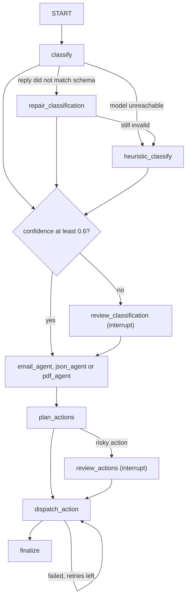

# FlowBit

A FastAPI service that takes an uploaded email, JSON payload or PDF, classifies
it, hands it to a specialised agent, and triggers follow-up actions over HTTP.
The pipeline is a LangGraph state graph. The default model is a local one served
by Ollama, so no API key or paid service is needed. Gemini is optional.

## What the pipeline does



- **Structured output.** Every model call asks for a Pydantic schema from
  `app/schemas` through LangChain's `with_structured_output`. There is no code
  fence stripping.
- **Repair, then heuristic.** If the classifier's reply does not match the
  schema, `repair_classification` sends the bad reply and the validation error
  back to the model once. If that fails too, or the model cannot be reached,
  `heuristic_classify` uses keyword rules (confidence 0.5). The three agents
  do the same repair once inline, then fall back to their rule-based analysis.
- **Checkpoints.** Every step is saved to SQLite (`FLOWBIT_CHECKPOINT_DB`).
  On startup the app resumes runs that a crash or restart left unfinished;
  `POST /resume/{id}` resumes a run that failed with an error.
- **Human review.** The run pauses (LangGraph `interrupt`) when classifier
  confidence is below `FLOWBIT_MIN_CONFIDENCE`, or before sending an action
  listed in `FLOWBIT_RISKY_ACTIONS`. `POST /review/{id}` resumes it.
- **Retries.** A failed action loops back into `dispatch_action` up to 3
  more times with 1 s, 2 s, 4 s backoff. After that a response marked
  `"mock": true` is recorded, as before.

### Action rules

| Agent output | Action |
|---|---|
| email `analysis.urgency == "high"` | `notification` |
| JSON `parsed_data.amount` or `parsed_data.data.amount` > 10000 | `risk_alert` (risky) |
| PDF `compliance_check.keywords_found` not empty | one `compliance` action (risky), `alert_type` `gdpr_mention` when GDPR is found or risk is high |

## API

| Method | Path | Purpose |
|---|---|---|
| GET | `/` | upload page |
| POST | `/process` | upload a file (form field `file`), returns `process_id` |
| GET | `/status/{id}` | status, classification, agent output, actions, and `review_request` while paused |
| GET | `/history` | last 100 runs |
| POST | `/review/{id}` | answer a paused run: `{"approved": true}`; for a classification review you can also send `input_type` and `business_intent` |
| POST | `/resume/{id}` | continue a failed run from its last checkpoint |

Statuses: `running`, `classified`, `processed`, `awaiting_review`, `completed`,
`rejected`, `error`.

## Run it locally on Windows with Ollama

Install Ollama from https://ollama.com/download (or `winget install Ollama.Ollama`),
then in PowerShell:

```powershell
ollama pull llama3.2
```

```powershell
git clone https://github.com/adityaanikam/AI_agent_project.git
```

```powershell
cd AI_agent_project
```

```powershell
py -3.11 -m venv .venv
```

```powershell
.venv\Scripts\Activate.ps1
```

```powershell
pip install -r requirements-dev.txt
```

```powershell
python -m pytest
```

```powershell
python scripts/eval_classifier.py
```

```powershell
uvicorn main:app --reload
```

Open http://localhost:8000 and upload a file, or in a second PowerShell window
(with the venv active) run `python scripts/smoke_api.py` to upload the three
`test_sample.*` files. To answer a paused run:

```powershell
Invoke-RestMethod -Method Post -Uri http://localhost:8000/review/PROCESS_ID -ContentType "application/json" -Body '{"approved": true}'
```

Use a new `.venv`: the `venv/` folder in the repository was committed from
another machine.

## Configuration

Set these as environment variables or in a `.env` file.

| Variable | Default | Meaning |
|---|---|---|
| `FLOWBIT_LLM_PROVIDER` | `ollama` | `ollama`, `gemini` or `fake` (scripted model, no network) |
| `OLLAMA_MODEL` | `llama3.2` | any model you have pulled |
| `OLLAMA_BASE_URL` | `http://localhost:11434` | Ollama server |
| `GEMINI_MODEL` | `gemini-2.5-flash` | used when the provider is `gemini` |
| `GOOGLE_API_KEY` | none | needed only for `gemini` |
| `FLOWBIT_MIN_CONFIDENCE` | `0.6` | classifications below this wait for review |
| `FLOWBIT_RISKY_ACTIONS` | `risk_alert,compliance` | action types that wait for approval; empty for none |
| `FLOWBIT_MAX_RETRIES` | `3` | retries per action after the first attempt |
| `FLOWBIT_RETRY_BASE_DELAY` | `1.0` | seconds; the wait doubles each retry |
| `FLOWBIT_CHECKPOINT_DB` | `checkpoints.db` | LangGraph checkpoint file |
| `FLOWBIT_RESUME_ON_STARTUP` | `1` | `0` turns off resuming unfinished runs at startup |
| `DATABASE_URL` | `sqlite:///./flowbit.db` | processing records shown by `/status` and `/history` |
| `CRM_ENDPOINT`, `RISK_ALERT_ENDPOINT`, `COMPLIANCE_ENDPOINT`, `NOTIFICATION_ENDPOINT` | `http://localhost:800x/...` | action targets |

Gemini (optional): `pip install -r requirements-gemini.txt`, then set
`FLOWBIT_LLM_PROVIDER=gemini` and `GOOGLE_API_KEY`.

## Tests

`python -m pytest` runs 81 tests with the fake chat model and mocked HTTP. No
network or model is needed. The Gemini factory test is skipped unless
`langchain-google-genai` is installed. Measured on this branch: 81 passed on
Python 3.13 with Gemini installed; 80 passed and 1 skipped on a fresh Python
3.11 install from `requirements-dev.txt`.

## Classifier evaluation

`scripts/eval_classifier.py` runs the app's classification nodes over
`eval/samples.jsonl` (12 labelled samples: 4 emails, 4 JSON, 4 PDFs) and
prints accuracy and confusion tables for `input_type` and `business_intent`.
The sample format and how to add samples are in `eval/README.md`.

```powershell
python scripts/eval_classifier.py --provider fake
```

With `--provider fake` no model answers, so this measures the keyword
heuristic alone. Measured result:

| | accuracy |
|---|---|
| input_type | 12/12 (100%) |
| business_intent | 9/12 (75%) |

The three misses: a fraud email read as RFQ, a fraud JSON event read as
Invoice, and a certificate read as Complaint (the word "Issued" contains
"issue").

Accuracy with an Ollama model has not been measured yet. Run
`python scripts/eval_classifier.py` with Ollama running to measure it. The
`Answer source` line shows how many answers came from the model, the repair
step or the heuristic.

## Layout

```
app/
  agents/    classifier, email, JSON and PDF agents
  core/      processing records (SQLAlchemy) and action rules / HTTP delivery
  graph/     LangGraph state, graph builder, runner with SQLite checkpoints
  schemas/   Pydantic models used for structured output and the review API
  llm.py     model factory, fake chat model, structured-output and repair helpers
eval/        labelled samples for the classifier evaluation
scripts/     eval_classifier.py, smoke_api.py, make_text_pdf.py
tests/       pytest suite
main.py      FastAPI app
```

EXPLAIN.md describes each module and why it is built the way it is.

The Docker files were updated to pass the Ollama settings but have not been
re-tested since this change.
